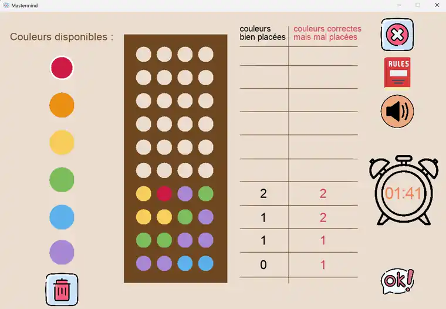
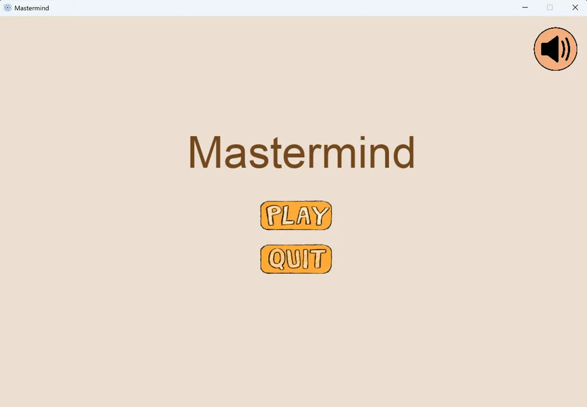
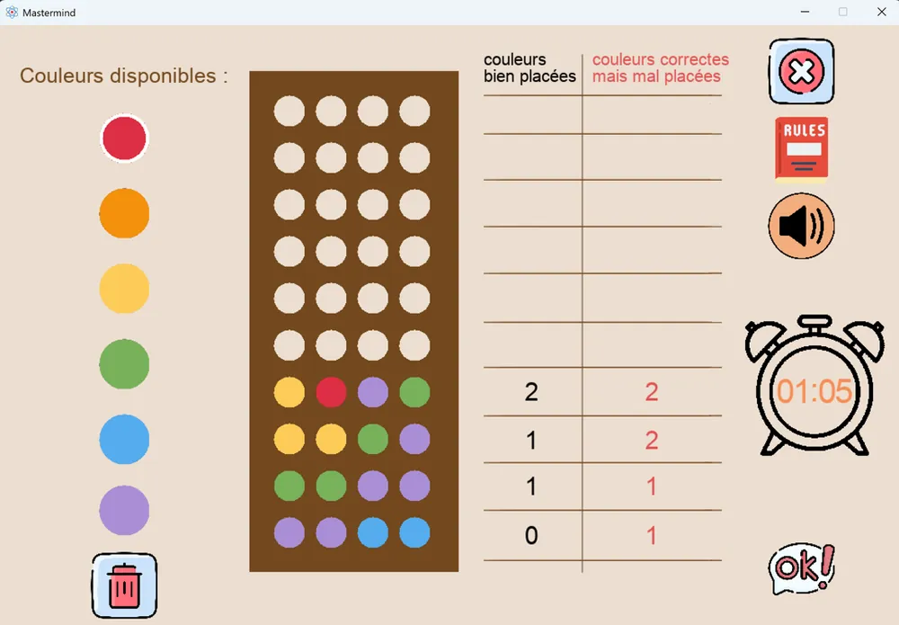
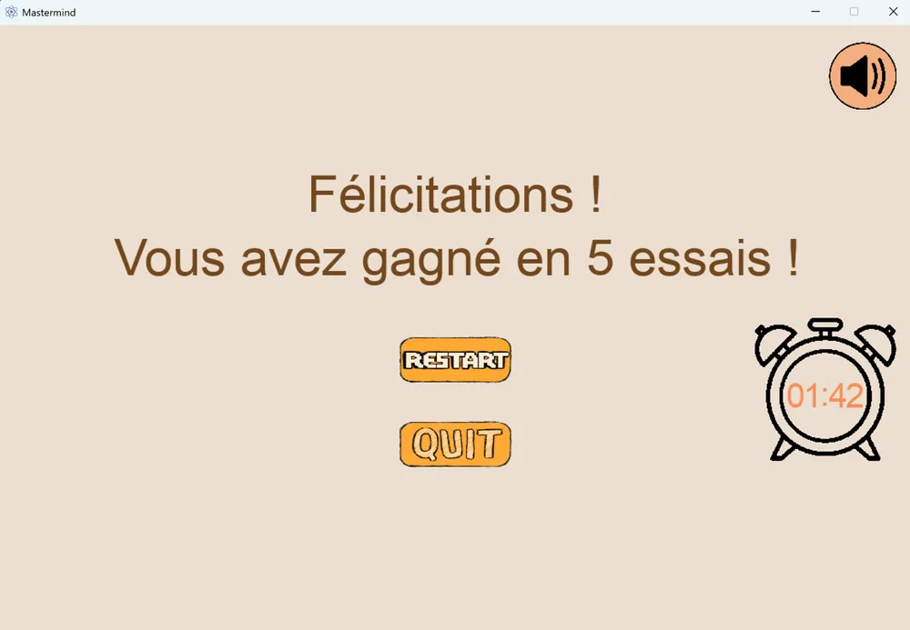
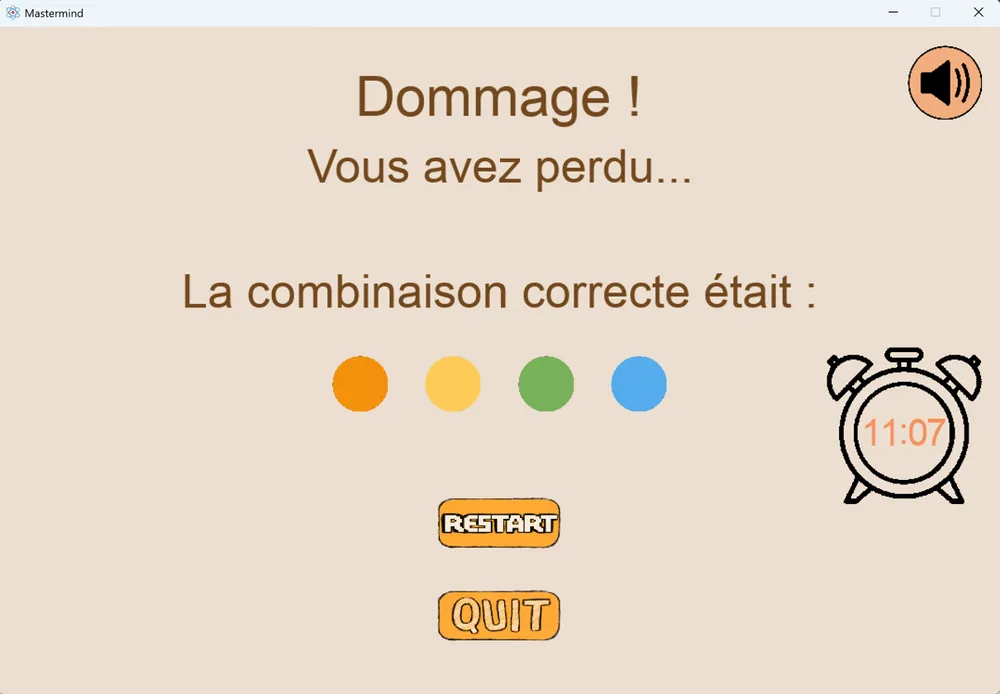

# Mastermind

A complete graphical implementation of the classic logic game **Mastermind**, built from scratch in Python with [Pygame](https://www.pygame.org/).

The computer picks a secret combination of four coloured pegs and the player has ten attempts to guess it. After each guess, the game gives feedback on how many pegs are the right colour and how many are both the right colour **and** in the right position, and the player uses this information to deduce the hidden code.

> **Note on language:** this was a school project, so the in-game text and the code comments are in **French**, while the variable and function names are mostly in **English**. This README is in English.

---

## Demo

<!-- Drop your media in a media/ folder and the paths below will work. -->



*A full round: picking colours, placing them on the grid, validating a guess and reading the hints (correct colour **and** place on the left, correct colour but wrong place on the right).*

<p align="center">
  
  
  
  
</p>

<p align="center"><sub>Start menu · a game in progress · the win screen · the lose screen (which reveals the secret code).</sub></p>

---

## About this project

We built this in 2022 as our first substantial programming project, during the **Première NSI** course (*Numérique et Sciences Informatiques*, the French high-school computer-science specialism). We then extended and polished it to enter the **[Trophées NSI 2022](https://trophees-nsi.fr/resultats-2022)**, a national competition for high-school NSI projects, where it was awarded **Best First-Year Project ("Meilleur projet - Première")** for the Île-de-France : Créteil region.

It was written entirely by hand, without AI assistance, and was the project that taught us the fundamentals of structuring a real program: the game loop, event handling, state management, and separating logic from display.

**Authors:** Nathan Conti Alunno and Emma Faye

---

## Features

- **Full graphical interface** rendered with Pygame, with custom-drawn buttons, grid and feedback table built from image assets.
- **Core game logic**: a random secret code of 4 pegs drawn from 6 colours (red, orange, yellow, green, blue, purple), each colour usable up to twice, over 10 attempts.
- **Hint system**: after every validated guess the game displays the number of correct colours in the right place and the number of correct colours in the wrong place, including the tricky duplicate-colour cases.
- **Interactive play**: pick a colour, place it on the grid, erase and replace pegs, and validate a row only once it is complete.
- **Timer** displayed live during the game, with a 59:59 time limit after which the game is lost.
- **Sound**: looping background music plus win/lose sound effects, with a toggle to mute at any time.
- **Rules screens** accessible from the main menu and during a game.
- **Win / lose screens** showing the number of attempts used (or revealing the secret combination on a loss), with an option to replay or quit.

---

## Requirements

- Python 3.9+
- Pygame

Install the dependency with:

```bash
pip install pygame
```

(or `pip install -r requirements.txt`)

---

## Running the game

From the project folder:

```bash
python Projet_Mastermind.py
```

> The game loads its images, fonts and sounds using **relative paths** (`pictures/`, `font/`, `sounds/`), so it must be launched from inside the project directory for the assets to be found.

---

## How to play

1. On the start menu, click **Start** (or **Quit** to exit). The rules appear; click the arrow to continue.
2. **Pick a colour** from the six buttons on the left, then **click a cell** on the lowest open row of the grid to place it. You can only fill the bottom-most row.
3. To change a peg, click it again after selecting another colour, or use the **bin** button to erase.
4. Once a row is completely filled, press **OK** to validate. The feedback table fills in: how many pegs are the right colour and well placed (left column) and how many are the right colour but misplaced (right column).
5. Crack the code within **10 attempts** (and under the time limit) to win.

---

## Project structure

```
Mastermind/
├── Projet_Mastermind.py   # the full game (single file)
├── pictures/              # buttons, grid, backgrounds, icons
├── sounds/                # music and sound effects
└── font/                  # the font used for all in-game text
```

The code is organised into:
- a `Button` class (handles drawing and click detection) and a `Text` class (renders on-screen text);
- the main game loop (`game_menu`) and the logic functions (`choice_combination`, `comparison_combinations`);
- the menu / rules / win / lose screens.

---

## Limitations & honest notes

This is an early project kept here largely as-is, so a few things reflect that:
- There are **no automated tests** (no `pytest` suite); the game was tested by playing it.
- Game state is held in **module-level global variables**, which we would handle differently today (e.g. a game-state class).
- Layout coordinates are hard-coded, so the window is a fixed 1080×720.

I've chosen to publish the project here as it was, rather than rewrite it. It's an honest snapshot of where we were when we started programming.

---

## License

Released under the [MIT License](LICENSE). The image, font and sound assets are included for the game to run; please check their respective licences before reusing them elsewhere.
